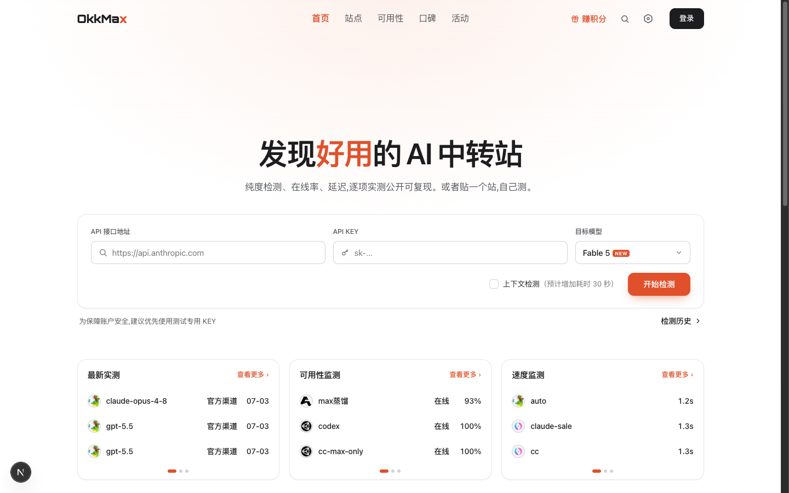
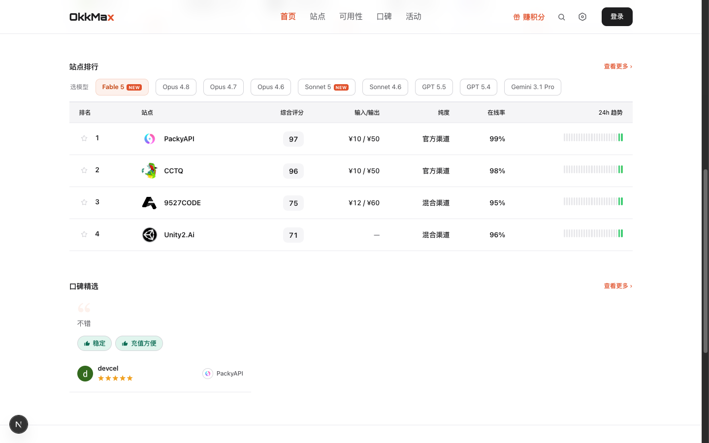
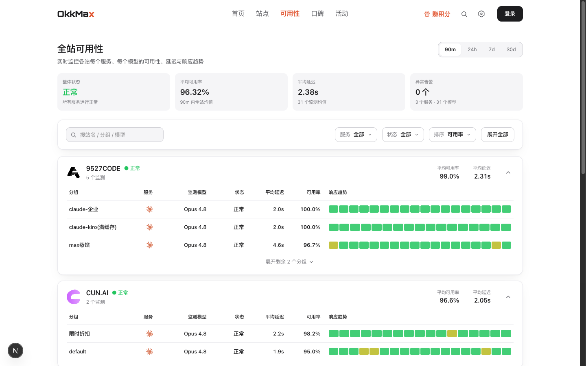
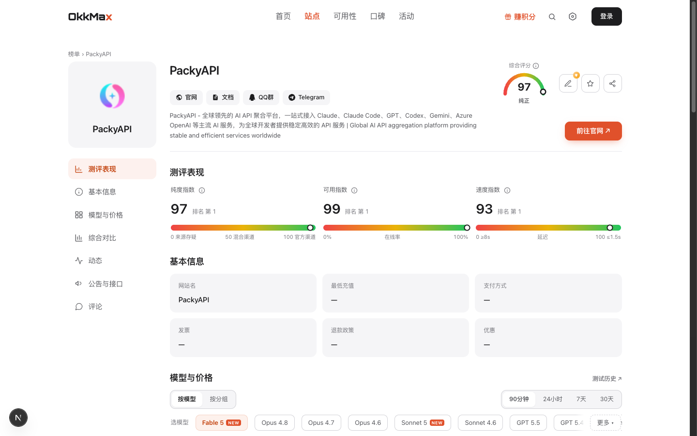
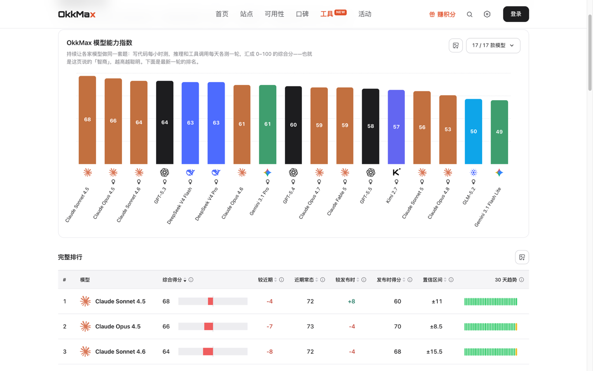

<div align="center">

# OkkMax：AI API 中转站测评与排行榜

### Claude、GPT、Gemini 中转站纯度检测、降智识别、可用性监测与真实口碑

[](https://www.okkmax.com)
[](LICENSE)
[](https://nextjs.org)
[](https://www.prisma.io)
[](https://github.com/fanbidog/okkmax-web/pulls)
[](https://github.com/fanbidog/okkmax-web/stargazers)

**[在线访问 www.okkmax.com](https://www.okkmax.com)**

独立第三方的 AI API 中转站测评与导航平台。
榜单分数全部来自自动探针，判定方法公开可审计，不收取任何影响排名的费用。

[English](README_EN.md) | 中文

</div>

## 赞助商

> [想出现在这里？](https://www.okkmax.com/about)

<details open>
<summary>点击折叠</summary>

<table>
<tr>
<td width="180"><a href="https://www.packyapi.ai"></a></td>
<td>感谢 PackyCode 赞助了本项目！PackyCode 是一家稳定、高效的 API 中转服务商，提供 Claude Code、Codex、Gemini 等多种中转服务。点击 <a href="https://www.packyapi.ai">此链接</a> 了解详情。</td>
</tr>
</table>

</details>

---

## 核心模块

OkkMax 解决的是买中转站之前的决策问题：这家站点是不是真的 Claude，现在能不能用，别人用下来怎么样。

| 模块 | 解决的问题 | 入口 |
| --- | --- | --- |
| 站点排行 | 横向对比各中转站的纯度档位、在线率、速度、价格、模型覆盖和支付条款，支持推荐、最新、可用率、价格排序 | [AI 中转站排行榜](https://www.okkmax.com/list) |
| 模型中转站榜 | 按模型看哪些中转站提供它，以及各自的价格与可用性 | [模型榜单](https://www.okkmax.com/model) |
| 纯度检测 | 识别中转站是否把 Claude 偷换成廉价模型，每次检测都有公开报告页 | [首页检测入口](https://www.okkmax.com) |
| 可用性监测 | 各站各分组持续探测，查看 90 分钟、24 小时、7 天、30 天的在线率与延迟趋势 | [可用性监测](https://www.okkmax.com/availability) |
| 模型智商榜 | 主流大模型的能力分每日同步，对比各自基线，看谁在悄悄降智 | [模型智商榜](https://www.okkmax.com/tools/iq) |
| 口碑社区 | 真实用户的评分、评价与优缺点标签，补充探针测不到的客服、售后和充值体验 | [口碑](https://www.okkmax.com/reputation) |
| Agent 接入 | 让 AI Agent 通过 MCP、Skills 和 llms.txt 直接查询测评数据 | [开发者与 AI Agent 接入](https://www.okkmax.com/developers) |

## 适合谁

- **正在选 Claude、GPT、Gemini 中转站的开发者**：想知道哪些站点跑的是真模型、哪家更便宜、哪家更稳。
- **已经在用某个中转站、怀疑被降智的人**：想核实模型有没有被偷换，或者看一眼最近的可用性。
- **中转站站主**：想让自己的站点被收录，或对分数有异议申请复测。
- **使用 AI Agent 的人**：想让 Claude Code、Codex、Cursor 之类的工具直接帮你查中转站。

## 为什么做 OkkMax

AI API 中转站鱼龙混杂：有的走真官方渠道，有的偷偷把 Claude 换成廉价模型（俗称降智或偷换），有的今天能用明天跑路。买之前没法验货，买之后掉坑才知道。

OkkMax 用两条互相独立的轨道帮你把关：

- **机器客观实测**：用被测站自己的账号定时探测，覆盖真伪验证（基于 Anthropic 思维签名，无法伪造）、在线率、响应延迟和价格。数据自动入库，人工改不了。
- **用户真实口碑**：真实用户的评分、评价与优缺点标签，覆盖探针测不到的体验。

两条轨道分开统计、互为补充，让选中转站从赌运气变成看数据。

## 功能一览

**排名与对比**

- 站点排行默认按综合排名分排序，排名分由在线率与速度计算；首页和排行页可切换推荐、最新、可用率、价格排序
- 站点对比口径包括纯度档位、模型覆盖、价格、支付与服务条款，可按模型筛选，覆盖 Claude、GPT、Gemini 全系
- 模型中转站榜单：每个模型一页，列出提供该模型的中转站、价格与可用性
- 中国大陆访问检测：官网在大陆无法访问的站点会标注「访问异常」，并在排名中降位
- 价格对比：各站各模型的输入、输出价格一目了然，价格变动自动记入站点动态

**检测与监测**

- 纯度检测：基于思维签名的真伪验证，三档判定（官方渠道、混合渠道、来源存疑），抓出降智偷换
- 检测报告页：每次检测生成可公开访问的报告页，标明检测时间与逐项结果，并向搜索引擎开放收录
- 可用性监测：分钟级持续探测，90 分钟、24 小时、7 天、30 天在线率与延迟趋势；PC 端提供卡片和表格两种视图，手机端为卡片布局
- 自带 Key 自测：贴上接口地址和 Key，即时检测任意站点；Key 用完即弃，不落库

**数据与工具**

- 模型智商榜：Claude、Codex、GPT、Gemini 的能力分每日同步，带 30 天趋势、推理、代码、工具调用分项排名，图表可导出
- AI API 测速工具：支持 Messages 与 Responses 两种接口格式的测速
- Codex 额度重置记录：重置日历与间隔统计
- Codex 皮肤库：界面配色加壁纸，一条命令换肤
- 站点动态：涨降价、模型上下架、纯度档位变化，自动生成事件流，支持 RSS 订阅

**社区与账号**

- 口碑社区：评分、评价、优缺点标签，一人一票
- 积分与商城：签到、检测、评价赚积分，在积分商城兑换权益，支持邀请拉新
- 中英双语：英文版使用独立的 `/en` 路径，内容预翻译

## 给 AI Agent 用

OkkMax 的测评数据可以被 AI Agent 直接读取，匿名、只读，不需要注册。接入方式见 [开发者与 AI Agent 接入](https://www.okkmax.com/developers)，里面按客户端给出了命令，已覆盖 Claude Code、Codex、Cursor。

**MCP 服务**

- 地址：`https://www.okkmax.com/mcp`（Streamable HTTP，无需认证）
- 提供 6 个只读工具：

| 工具 | 用途 |
| --- | --- |
| `search_stations` | 按站名、域名、网址或模型搜索中转站 |
| `search_models` | 查找模型的标准 slug |
| `get_model_board` | 查看某个模型下各中转站的榜单 |
| `find_cheapest_relay` | 在指定在线率等条件下找最低价的中转站 |
| `get_station` | 读取单个中转站的完整报告，可限定到某个模型和分组 |
| `explain_methodology` | 说明评分与纯度档位的判定口径 |

**Skills**

- `okkmax-find-relay`：为某个模型挑选和对比中转站
- `okkmax-check-relay`：核实某一家中转站是否靠谱

**面向 Agent 的文本入口**

- [llms.txt](https://www.okkmax.com/llms.txt) 与 [llms-full.txt](https://www.okkmax.com/llms-full.txt)
- 每个站点和每个模型都有 Markdown 页面：`/station/<slug>.md`、`/model/<slug>.md`
- [评测方法](https://www.okkmax.com/methodology.md)

MCP 与 Skills 的插件包单独发布在 [Okkmass/okkmax-agent-plugin](https://github.com/Okkmass/okkmax-agent-plugin)，采用 MIT 许可。

## 界面预览

|               首页与自测入口               |               站点排行               |
| :-----------------------------------------: | :----------------------------------: |
|         |  |

|               可用性监测                |               站点详情               |
| :-------------------------------------: | :----------------------------------: |
|  |  |

|              模型智商榜              |
| :----------------------------------: |
|  |

## 我们不做什么

- 不收取影响排名的费用。榜单分数全部来自自动探针，商业合作（如返佣外链）不改变探针数据与档位判定。
- 不替任何中转站担保。检测、评分与排名是基于既定方法的客观呈现，不构成推荐或背书，是否使用由你自己决定。
- 不保存你的 API Key。自测时的 Key 仅用于当次检测，不写数据库，不留日志。

## 快速开始（自部署）

要求：Node.js 20+、PostgreSQL。

```bash
git clone https://github.com/fanbidog/okkmax-web.git
cd okkmax-web
npm install
cp .env.example .env       # 填 DATABASE_URL
cp .env.example .env.local # 填其余变量（按需）
npx prisma migrate deploy
npx prisma generate
npm run dev
```

可选：灌入演示数据看页面效果。

```bash
npx tsx scripts/seed-test-stations.ts   # 三个演示站点 + 评价
npx tsx scripts/seed-content.ts         # 帮助中心文档
```

### 常用命令

```bash
npm run dev     # 开发
npm run build   # 生产构建
npm run test    # 单测（vitest）
npm run ingest  # 手动收录站点（格式见 scripts/seed.example.json）
npm run score   # 计算评分与排名（建议 cron 定时跑）
```

### 架构说明

本仓库是 OkkMax 的网站与数据展示层（Next.js 16 全栈 + Prisma + PostgreSQL）。完整运行一套自己的测评平台还需要：

- **检测后端**：执行单次站点检测，通过 `DETECT_BASE_URL` 接入；未配置时「自带 Key 自测」返回 501，其余功能不受影响
- **可用性监测**：持续采集在线率与延迟，写入本应用数据库（`UptimeSnapshot` 等表）
- **评分口径**：权重与系数通过 `SCORE_*` 环境变量配置，见 [.env.example](.env.example)

## FAQ

<details>
<summary><strong>怎么选 Claude 中转站？</strong></summary>

先看纯度档位，确认站点跑的是真官方渠道，再比较在线率、延迟和价格。在 [站点排行](https://www.okkmax.com/list) 可以按模型筛选，在 [模型榜单](https://www.okkmax.com/model) 可以直接看某个模型下各站的对比。

</details>

<details>
<summary><strong>怎么判断中转站有没有降智、偷换模型？</strong></summary>

看纯度检测的结果。OkkMax 对 Claude 用思维签名验证，能识别把 Claude 换成廉价模型的站点；模型智商榜则对比各模型自己的能力基线，提示模型本身有没有变弱。

</details>

<details>
<summary><strong>榜单排名会收钱吗？</strong></summary>

不会。榜单分数全部来自自动探针，判定方法公开；商业合作（如返佣外链）不改变探针数据与档位判定。

</details>

<details>
<summary><strong>纯度检测的原理是什么？</strong></summary>

核心是 Anthropic 官方后端返回的思维签名（thinking signature），一段无法伪造的加密标记。拿到有效签名且行为与官方一致，即可认定走的是真官方渠道。GPT 和 Gemini 没有等价签名，只做协议级测试（连通性、速度、在线率）。详见 [评测方法](https://www.okkmax.com/methodology.md)。

</details>

<details>
<summary><strong>怎么让 AI Agent 帮我查中转站？</strong></summary>

在 Claude Code、Codex 或 Cursor 里接入 OkkMax 的 MCP 服务和 Skills，之后直接问 Agent 即可，比如让它推荐某个模型的中转站，或核实某一家是否靠谱。步骤见 [开发者与 AI Agent 接入](https://www.okkmax.com/developers)。

</details>

<details>
<summary><strong>我是站主，怎么收录我的站？</strong></summary>

到 [www.okkmax.com/submit](https://www.okkmax.com/submit) 提交站点信息即可；对分数有异议可申请复测。

</details>

<details>
<summary><strong>自测时填的 API Key 安全吗？</strong></summary>

Key 仅用于发起当次检测，用完即弃，不写数据库，不留日志。建议使用测试专用 Key。

</details>

## Star History

<a href="https://www.star-history.com/?repos=fanbidog%2Fokkmax-web&type=date&legend=top-left">
 <picture>
   <source media="(prefers-color-scheme: dark)" srcset="https://api.star-history.com/chart?repos=fanbidog/okkmax-web&type=date&theme=dark&legend=top-left&sealed_token=qPoWs19t8OTLx3nj6xu-AygbsiZTzFNGU5pfUpmssX2-kxUa2bwymwwkzGjijSBix5PdcjQykY1uBuCW5jHgOuRrkPmGYi3Mlp5ehiZ-eTsUwkH_bnWoQ6jT3qCMz7dYwfP21D5LHQy6kjtOTbXt6Bo69VzVPIE8do8t3_hrzC231O9q1s2E-hGwNntR" />
   <source media="(prefers-color-scheme: light)" srcset="https://api.star-history.com/chart?repos=fanbidog/okkmax-web&type=date&legend=top-left&sealed_token=qPoWs19t8OTLx3nj6xu-AygbsiZTzFNGU5pfUpmssX2-kxUa2bwymwwkzGjijSBix5PdcjQykY1uBuCW5jHgOuRrkPmGYi3Mlp5ehiZ-eTsUwkH_bnWoQ6jT3qCMz7dYwfP21D5LHQy6kjtOTbXt6Bo69VzVPIE8do8t3_hrzC231O9q1s2E-hGwNntR" />
   
 </picture>
</a>

## License

[OkkMax Non-Commercial License](LICENSE) © OkkMax

---

<div align="center">

[官网](https://www.okkmax.com) | [站点排行](https://www.okkmax.com/list) | [模型榜单](https://www.okkmax.com/model) | [模型智商榜](https://www.okkmax.com/tools/iq) | [可用性监测](https://www.okkmax.com/availability) | [开发者接入](https://www.okkmax.com/developers) | [提交站点](https://www.okkmax.com/submit)

</div>
