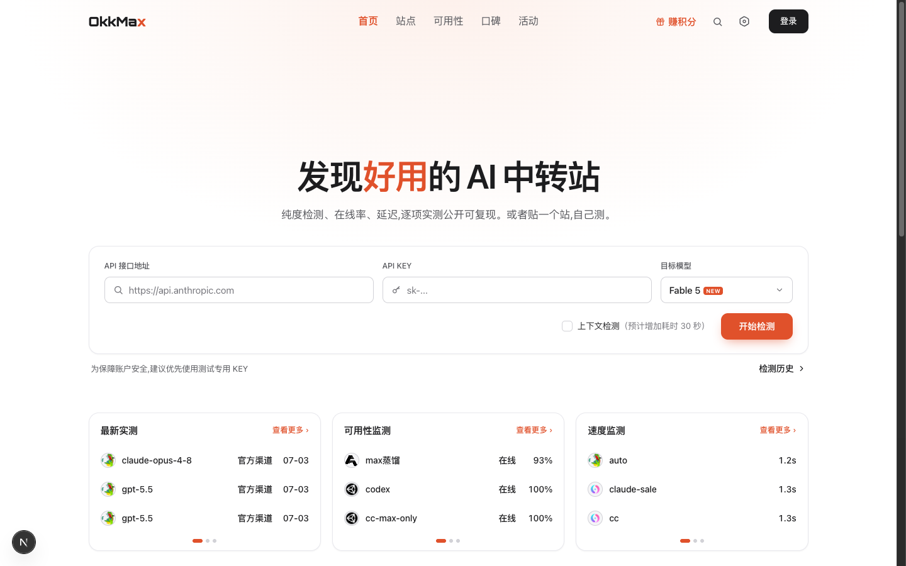
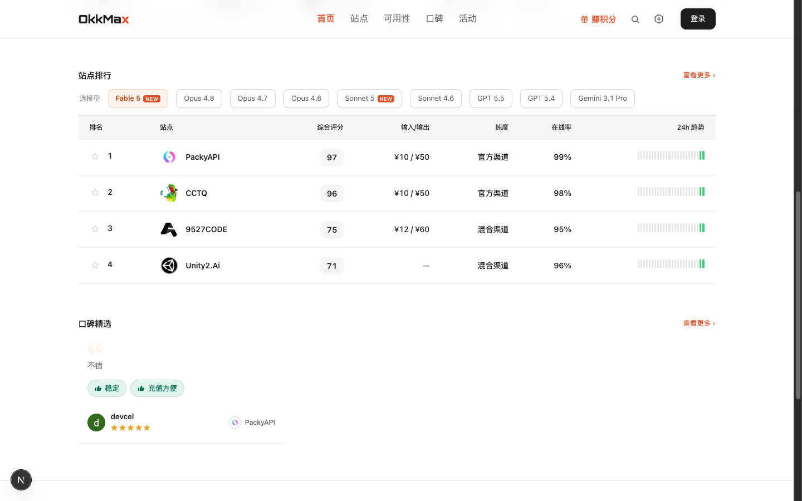
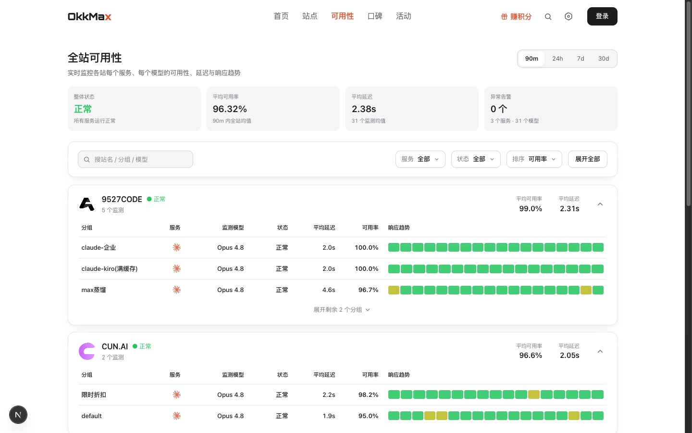
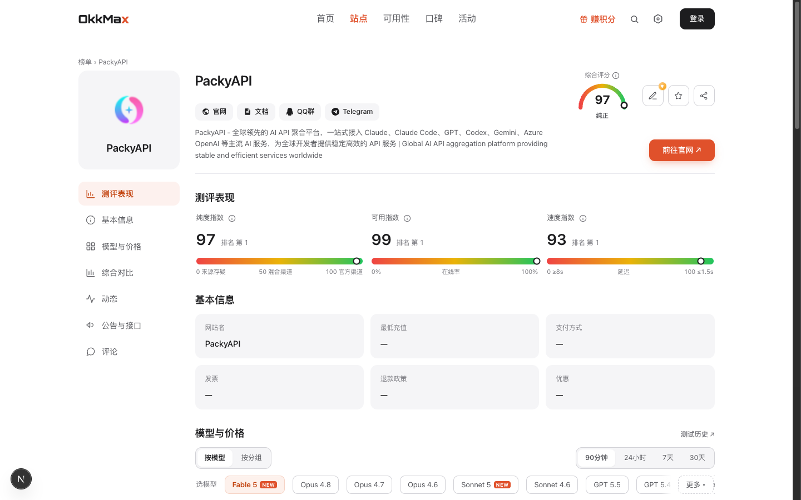
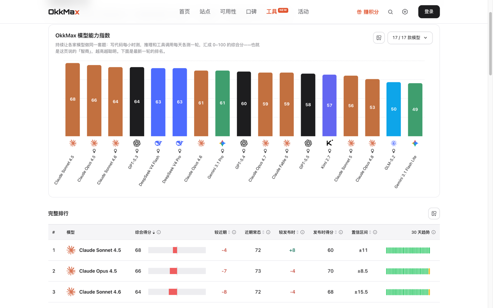

<div align="center">

# OkkMax: AI API Relay Review and Leaderboard

### Purity checks, downgrade detection, uptime monitoring and real reviews for Claude, GPT and Gemini relay providers

[](https://www.okkmax.com/en)
[](LICENSE)
[](https://nextjs.org)
[](https://www.prisma.io)
[](https://github.com/fanbidog/okkmax-web/pulls)
[](https://github.com/fanbidog/okkmax-web/stargazers)

**[Visit www.okkmax.com](https://www.okkmax.com/en)**

An independent, third-party review and directory for AI API relay providers.
Every ranking score comes from automated probes, the methodology is public and auditable, and no fee can change a ranking.

English | [中文](README.md)

</div>

## Sponsors

> [Want to appear here?](https://www.okkmax.com/en/about)

<details open>
<summary>Click to collapse</summary>

<table>
<tr>
<td width="180"><a href="https://www.packyapi.ai"></a></td>
<td>Thanks to PackyCode for sponsoring this project. PackyCode is a stable, efficient API relay provider offering Claude Code, Codex, Gemini and more. See <a href="https://www.packyapi.ai">this link</a> for details.</td>
</tr>
</table>

</details>

---

## Core modules

OkkMax answers the questions you have before buying from a relay provider: is it really Claude, is it up right now, and how has it worked out for other people.

| Module | What it answers | Link |
| --- | --- | --- |
| Provider ranking | Compare purity tier, uptime, speed, price, model coverage and payment terms side by side; sort by recommended, newest, uptime or price | [AI relay ranking](https://www.okkmax.com/en/list) |
| Model boards | For each model, which providers offer it, at what price and with what uptime | [Model boards](https://www.okkmax.com/en/model) |
| Purity check | Detects providers that swap Claude for a cheaper model; every check has a public report page | [Run a check on the home page](https://www.okkmax.com/en) |
| Uptime monitoring | Continuous probing per provider and group, with 90-minute, 24-hour, 7-day and 30-day uptime and latency trends | [Uptime monitoring](https://www.okkmax.com/en/availability) |
| Model IQ leaderboard | Capability scores of mainstream models, synced daily against each model's own baseline, so you can see who is quietly getting dumber | [Model IQ](https://www.okkmax.com/en/tools/iq) |
| Review community | Real user ratings, reviews and pros/cons tags, covering support, after-sales and top-up experience that probes cannot measure | [Reviews](https://www.okkmax.com/en/reputation) |
| Agent access | Let AI agents query the review data directly through MCP, Skills and llms.txt | [Developers and AI agents](https://www.okkmax.com/developers) |

## Who it is for

- **Developers choosing a Claude, GPT or Gemini relay provider**: find out which providers run the real model, which is cheaper and which is more stable.
- **People already using a relay and suspecting a downgrade**: verify whether the model was swapped, or check recent uptime.
- **Relay operators**: get your provider listed, or request a re-test if you dispute a score.
- **People who work with AI agents**: let Claude Code, Codex, Cursor and similar tools look up relay providers for you.

## Why OkkMax

AI API relay providers vary widely. Some route through genuine official channels, some quietly swap Claude for a cheaper model (commonly called downgrading or model swapping), and some disappear overnight. You cannot inspect the goods before buying, and you only find out after you have been burned.

OkkMax uses two independent tracks:

- **Objective machine probing**: scheduled probes through each provider's own account, covering authenticity (based on Anthropic's thinking signature, which cannot be forged), uptime, latency and price. Data is written to the database automatically and cannot be edited by hand.
- **Real user reviews**: ratings, reviews and pros/cons tags from real users, covering what probes cannot see.

The two tracks are counted separately and complement each other, turning provider selection from a gamble into a data-driven choice.

## Features

**Ranking and comparison**

- The provider ranking defaults to a composite score built from uptime and speed; the home and ranking pages can also sort by recommended, newest, uptime or price
- Comparison covers purity tier, model coverage, price, payment and service terms, filterable by model, across the whole Claude, GPT and Gemini lineup
- Model boards: one page per model, listing the providers that offer it with price and uptime
- Mainland China access check: providers whose official site is unreachable from mainland China are labelled "access issue" and ranked lower
- Price comparison: input and output prices per model per provider at a glance; price changes are logged automatically as provider events

**Checks and monitoring**

- Purity check: authenticity verification based on the thinking signature, with three tiers (official channel, mixed channel, source in doubt), catching downgrades and model swaps
- Check report pages: every check produces a publicly accessible report with the check time and itemized results, open to search engine indexing
- Uptime monitoring: minute-level continuous probing with 90-minute, 24-hour, 7-day and 30-day uptime and latency trends; desktop offers card and table views, mobile uses cards
- Bring-your-own-key testing: paste an endpoint and key to test any provider instantly; keys are used once and discarded, never stored

**Data and tools**

- Model IQ leaderboard: capability scores for Claude, Codex, GPT and Gemini synced daily, with a 30-day trend and sub-rankings for reasoning, coding and tool use; charts can be exported
- AI API speed test: supports both the Messages and Responses API formats
- Codex quota reset log: reset calendar and interval statistics
- Codex skins: UI palette plus wallpaper, applied with one command
- Provider events: price changes, model additions and removals, and purity tier changes, auto-generated as an event feed with RSS

**Community and accounts**

- Review community: ratings, comments and pros/cons tags, one person one vote
- Points and shop: earn points from check-ins, tests and reviews, redeem them in the points shop, with invites supported
- Bilingual: the English site lives on its own `/en` path with pre-translated content

## For AI agents

OkkMax review data can be read directly by AI agents, anonymously and read-only, with no sign-up. Setup instructions per client are on [Developers and AI agent access](https://www.okkmax.com/developers), covering Claude Code, Codex and Cursor.

**MCP server**

- Address: `https://www.okkmax.com/mcp` (Streamable HTTP, no authentication)
- Six read-only tools:

| Tool | Purpose |
| --- | --- |
| `search_stations` | Search relay providers by name, domain, URL or model |
| `search_models` | Look up the canonical slug of a model |
| `get_model_board` | View the provider board for a given model |
| `find_cheapest_relay` | Find the lowest-priced provider under conditions such as a minimum uptime |
| `get_station` | Read the full report for one provider, optionally scoped to a model and group |
| `explain_methodology` | Explain how scores and purity tiers are determined |

**Skills**

- `okkmax-find-relay`: pick and compare relay providers for a model
- `okkmax-check-relay`: verify whether a specific relay provider is trustworthy

**Text entry points for agents**

- [llms.txt](https://www.okkmax.com/llms.txt) and [llms-full.txt](https://www.okkmax.com/llms-full.txt)
- A Markdown page for every provider and every model: `/station/<slug>.md`, `/model/<slug>.md`
- [Methodology](https://www.okkmax.com/methodology.md)

The MCP and Skills plugin package is published separately at [Okkmass/okkmax-agent-plugin](https://github.com/Okkmass/okkmax-agent-plugin) under the MIT license.

## Screenshots

|              Home and instant test              |              Provider ranking              |
| :---------------------------------------------: | :----------------------------------------: |
|             |  |

|              Uptime monitoring                |              Provider detail       |
| :-------------------------------------------: | :--------------------------------: |
|  |  |

|              Model IQ leaderboard              |
| :--------------------------------------------: |
|  |

## What we do not do

- We do not accept fees that affect rankings. Every score comes from automated probes; commercial arrangements such as referral links never change probe data or tier verdicts.
- We do not vouch for any relay provider. Checks, scores and rankings are an objective presentation of a fixed methodology, not a recommendation or endorsement; whether to use a provider is your own decision.
- We do not store your API key. A key used in a test serves that single check only, and is never written to the database or logs.

## Quick Start (self-hosting)

Requirements: Node.js 20+, PostgreSQL.

```bash
git clone https://github.com/fanbidog/okkmax-web.git
cd okkmax-web
npm install
cp .env.example .env       # set DATABASE_URL
cp .env.example .env.local # set the rest as needed
npx prisma migrate deploy
npx prisma generate
npm run dev
```

Optional: seed demo data to see the pages in action.

```bash
npx tsx scripts/seed-test-stations.ts   # three demo providers + reviews
npx tsx scripts/seed-content.ts         # help-center docs
```

### Common commands

```bash
npm run dev     # development
npm run build   # production build
npm run test    # unit tests (vitest)
npm run ingest  # manually ingest a provider (format: scripts/seed.example.json)
npm run score   # compute scores and rankings (run on a cron)
```

### Architecture notes

This repository is OkkMax's website and data presentation layer (Next.js 16 full-stack + Prisma + PostgreSQL). To run a complete review platform of your own you will also need:

- **A detection backend**: performs one-off provider tests, wired up via `DETECT_BASE_URL`; when unset, the bring-your-own-key test returns 501 and everything else works normally
- **An uptime monitor**: continuously collects uptime and latency and writes into this app's database (`UptimeSnapshot` and related tables)
- **Scoring configuration**: weights and coefficients are set via `SCORE_*` environment variables, see [.env.example](.env.example)

## FAQ

<details>
<summary><strong>How do I choose a Claude relay provider?</strong></summary>

Start with the purity tier to confirm the provider runs a genuine official channel, then compare uptime, latency and price. On the [provider ranking](https://www.okkmax.com/en/list) you can filter by model, and on the [model boards](https://www.okkmax.com/en/model) you can compare providers directly for a single model.

</details>

<details>
<summary><strong>How can I tell whether a relay downgraded or swapped the model?</strong></summary>

Look at the purity check result. For Claude, OkkMax verifies the thinking signature and can identify providers that replace Claude with a cheaper model. The model IQ leaderboard compares each model against its own capability baseline, showing whether the model itself has weakened.

</details>

<details>
<summary><strong>Can providers pay for a better ranking?</strong></summary>

No. All ranking scores come from automated probes and the methodology is public; commercial arrangements (such as referral links) never change probe data or tier verdicts.

</details>

<details>
<summary><strong>How does the purity check work?</strong></summary>

It relies on the thinking signature returned by Anthropic's official backend, a cryptographic marker that cannot be forged. A valid signature plus behaviour consistent with the official API confirms a genuine official channel. GPT and Gemini have no equivalent signature, so they only get protocol-level tests (connectivity, speed, uptime). See the [methodology](https://www.okkmax.com/methodology.md).

</details>

<details>
<summary><strong>How do I let an AI agent look up relay providers for me?</strong></summary>

Connect OkkMax's MCP server and Skills in Claude Code, Codex or Cursor, then ask the agent directly, for example to recommend providers for a model or to verify a specific one. Steps are on [Developers and AI agent access](https://www.okkmax.com/developers).

</details>

<details>
<summary><strong>I run a relay provider. How do I get listed?</strong></summary>

Submit your provider at [www.okkmax.com/submit](https://www.okkmax.com/submit); if you dispute a score you can request a re-test.

</details>

<details>
<summary><strong>Is my API key safe when I run a test?</strong></summary>

The key is used only for that single test and then discarded, never written to the database or logs. We recommend using a dedicated test key.

</details>

## Star History

<a href="https://www.star-history.com/?repos=fanbidog%2Fokkmax-web&type=date&legend=top-left">
 <picture>
   <source media="(prefers-color-scheme: dark)" srcset="https://api.star-history.com/chart?repos=fanbidog/okkmax-web&type=date&theme=dark&legend=top-left&sealed_token=qPoWs19t8OTLx3nj6xu-AygbsiZTzFNGU5pfUpmssX2-kxUa2bwymwwkzGjijSBix5PdcjQykY1uBuCW5jHgOuRrkPmGYi3Mlp5ehiZ-eTsUwkH_bnWoQ6jT3qCMz7dYwfP21D5LHQy6kjtOTbXt6Bo69VzVPIE8do8t3_hrzC231O9q1s2E-hGwNntR" />
   <source media="(prefers-color-scheme: light)" srcset="https://api.star-history.com/chart?repos=fanbidog/okkmax-web&type=date&legend=top-left&sealed_token=qPoWs19t8OTLx3nj6xu-AygbsiZTzFNGU5pfUpmssX2-kxUa2bwymwwkzGjijSBix5PdcjQykY1uBuCW5jHgOuRrkPmGYi3Mlp5ehiZ-eTsUwkH_bnWoQ6jT3qCMz7dYwfP21D5LHQy6kjtOTbXt6Bo69VzVPIE8do8t3_hrzC231O9q1s2E-hGwNntR" />
   
 </picture>
</a>

## License

[OkkMax Non-Commercial License](LICENSE) © OkkMax

---

<div align="center">

[Website](https://www.okkmax.com/en) | [Ranking](https://www.okkmax.com/en/list) | [Model boards](https://www.okkmax.com/en/model) | [Model IQ](https://www.okkmax.com/en/tools/iq) | [Uptime](https://www.okkmax.com/en/availability) | [Developers](https://www.okkmax.com/developers) | [Submit a provider](https://www.okkmax.com/submit)

</div>
